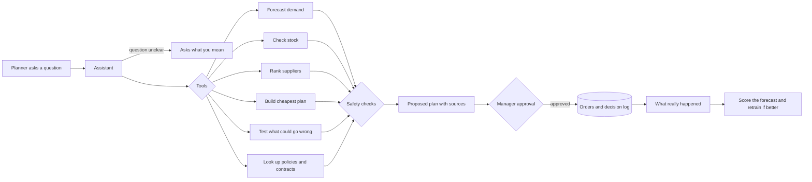

<div align="center">

# AI Supply Chain Planner

**Ask a planning question in plain English. Get a purchase plan with the numbers behind it. Nothing is bought until a manager approves it.**


[](LICENSE)


</div>

```text
"I'm worried we will run short on something next month. What should I do?"
"Demand for SKU-001 is expected to rise by 20%. What should I do?"
```

## What it does

A planner has to decide how much to buy, from which supplier, and for which warehouse. This app does the
analysis for them in four steps:

1. **Predict demand.** How much of each product will likely sell in each region over the next weeks, with a
   low-to-high range.
2. **Compare suppliers.** Price, delivery time and on-time record, side by side.
3. **Build the plan.** The cheapest way to buy enough stock without breaking any limit (minimum order sizes,
   supplier capacity, warehouse space, budget).
4. **Get it approved.** The plan goes to the right managers. Nothing is bought until they approve it.

It can also check what happens if something goes wrong (a supplier stops delivering, demand jumps), and it
answers questions about company policies and supplier contracts, quoting the exact source.

## Results

<div align="center">


</div>

The planning results come from a made-up sample company (fixed random seed, planning date 2024-12-30). The
forecast was also tested on real sales data from an online store. Every number below comes from a saved result
file in `ml/experiments/`; the full tables are in [`docs/benchmarks.md`](docs/benchmarks.md).

| What was measured | Simple approach | This app |
|---|---|---|
| Forecast error, sample company (units off per week, on average) | 33.9 with a 13-week average | **30.2**, 11.1% smaller |
| Forecast error, real store data | 58.2 with a 13-week average | **56.9**, 2.1% smaller |
| Cost of a 4-week purchase plan (40 products, 3 warehouses) | 348,675 if you always pick the cheapest supplier; 357,384 if you always pick the top-ranked one | **302,532**, 13% and 15% cheaper, with no limit broken |
| Same plan with a 15% smaller budget | both simple rules go over budget | **stays within budget** and still covers all demand |
| A supplier stops delivering | keep the plan: 94.1% of demand covered, cost 412,045 | **re-plan**: 100% covered, cost 306,750 |

| Other results | |
|---|---|
| Finding the right policy or contract (56 test questions) | the right document comes first for **94%** of the 34 questions that have an answer; every answer cites its source; restricted documents are **never** shown to the wrong role |
| Assistant safety (40 test cases) | it **never** orders without approval and **always** respects permissions |
| Assistant on new, unseen tasks | solves all **31** practice tasks but only **2 of 9** new ones, so it does not generalize well yet |
| Forecast ranges | actual sales fall inside the "likely range" **88%** of the time on the sample company (the range is a bit too wide) and **78%** on real data (target: 80%) |
| Retraining with new data | the new model was slightly worse (31.28 vs 31.18 units off), so it was **not** used |
| Speed (local Docker) | lists and lookups **11-14 ms**, a forecast **59 ms**, a policy question **100 ms**, a full assistant answer **under 1 second** |
| More workers for big jobs | **32 → 79 → 100** jobs per minute with 1, 2 and 4 workers |

How each number was produced: [`docs/forecasting.md`](docs/forecasting.md), [`docs/optimization.md`](docs/optimization.md),
[`docs/scenarios.md`](docs/scenarios.md), [`docs/rag-evaluation.md`](docs/rag-evaluation.md),
[`docs/agent-evaluation.md`](docs/agent-evaluation.md), [`docs/kubernetes.md`](docs/kubernetes.md). Weak results are listed
under [Limitations](#limitations).

## How it works



Three parts work together:

- **Website** (Next.js): what planners and managers use.
- **Backend** (Java, Spring Boot): sign-in, permissions, approvals, background jobs and the audit log, all stored
  in PostgreSQL.
- **Planning engine** (Python): forecasting, supplier ranking, plan building, what-if tests, document search and
  the assistant.

## Every number has a source

<div align="center">


</div>

- **No made-up numbers.** The assistant only uses numbers that a tool returned. A safety check blocks any answer
  that contains a number no tool produced.
- **It explains trade-offs.** For example, why the plan buys mostly from a supplier that isn't ranked first, or
  how much a supplier outage would cost if you keep the plan versus re-plan.
- **It asks when unsure.** A question without a product gets a follow-up question, not a guess.
- **You can see every step.** "How this was worked out" lists each tool it used, with inputs and results.

Details: [`docs/agent.md`](docs/agent.md).

## A manager approves before anything is bought

The assistant can only prepare an order. The company's approval policy decides who must sign off, for example a
procurement manager for orders above $15,000. People can't approve their own requests, the assistant can't
approve anything, and every decision is saved permanently along with who made it. Details:
[`docs/security.md`](docs/security.md).

## Answers from policies and contracts

Questions like "Who must approve an order above $20,000?" are answered from 69 company documents. Each answer
names the document and its version. Old or expired versions are flagged, questions without an answer in the
documents are declined, and people never see documents their role isn't allowed to read. Details:
[`docs/knowledge-retrieval.md`](docs/knowledge-retrieval.md).

## It learns, but only if the new model is better

When an order is approved, the app saves the forecast it was based on. Later, when real sales are recorded, it
compares the two. A retraining command builds a new forecast model from the new data and tests both models on
weeks neither has seen. The new model replaces the old one only if it is more accurate, and only after a named
person approves the switch.

```bash
uv run python -m scm_ml.feedback retrain
uv run python -m scm_ml.feedback promote --report <report.json> --approved-by <name>
```

Details: [`docs/feedback-loop.md`](docs/feedback-loop.md).

## Tech stack

| Area | Tools |
|---|---|
| Languages | Java, Python, TypeScript, SQL, HCL (Terraform), CSS |
| Backend | Java 21, Spring Boot 4 (web, security with JWT, JDBC, validation, actuator), Flyway, Maven |
| Website | Next.js 16, React 19, TypeScript, Vitest, Testing Library |
| Forecasting and planning | Python 3.12, LightGBM, NumPy, pandas, SciPy (HiGHS solver), FastAPI, Pydantic |
| Document search and assistant | fastembed (bge-small-en-v1.5), pgvector, BM25; optional Claude API |
| Data | PostgreSQL 16 with pgvector, a generated sample company, the Online Retail II dataset |
| Deployment | Docker Compose, Kubernetes (kind), Terraform for AWS (ECS Fargate, RDS, S3, EFS, ECR) |
| Monitoring | Micrometer, Prometheus endpoint, assistant usage stats, audit log |
| CI and quality | GitHub Actions, Trivy, pip-audit, npm audit, Ruff, mypy, pytest, JUnit, Testcontainers, actionlint, tflint |

## Quick start

You need [Docker](https://www.docker.com/products/docker-desktop/), bash (Git Bash on Windows) and
[uv](https://docs.astral.sh/uv/). No API key or cloud account is needed.

**1. Start everything** (the first run builds the images, so it takes a few minutes):

```bash
bash scripts/stack.sh up
```

It prints the address and a password at the end. The password is also saved in `.env` as `SCM_DEMO_PASSWORD`.

**2. Open http://localhost:3000 and sign in.** There is no sign-up page. Four demo accounts are created for you,
all with that same password:

| User id | What they can do |
|---|---|
| `planner` | ask the assistant, build plans, run what-if tests |
| `manager` | approve orders (procurement manager) |
| `finance` | approve large orders |
| `admin` | everything, plus the Monitoring page |

**3. Try the main flow:**

1. Sign in as `planner`, open **Assistant** and ask: *Demand for SKU-001 is expected to rise by 20%. What should I do?*
2. Sign out, sign in as `manager`, open **Approvals** and approve the new request.
3. Do the same as `finance`. Only now is the order placed.

Or run the same story as a script: `uv run python -m scm_ml.demo --password <password>` (a recorded run is in
[`docs/demo.md`](docs/demo.md)).

**4. Stop it** with `bash scripts/stack.sh down` (your data stays), or `bash scripts/stack.sh reset` to delete the
data too.

| Service | Address |
|---|---|
| Website | http://localhost:3000 |
| Backend API | http://localhost:8080 |
| Metrics | http://localhost:8081/actuator/prometheus |

To run it on a local Kubernetes cluster instead: `bash scripts/kind.sh up` ([`docs/kubernetes.md`](docs/kubernetes.md)).

## Local development

This needs Java 21, Node.js 24 and uv.

```bash
uv sync --frozen                                         # Python environment
uv run python -m scm_ml.synthetic --out data/synthetic --seed 42   # generate the sample company
uv run python -m scm_ml.forecast --source synthetic      # train the forecast model
uv run python -m scm_ml.service                          # planning engine on port 8001

cd backend && ./mvnw spring-boot:run                     # backend on port 8080 (needs PostgreSQL)
cd frontend && npm ci && npm run dev                     # website on port 3000
```

The backend needs `SCM_JWT_SECRET`, and the backend and engine share `SCM_ML_INTERNAL_TOKEN` (see
[Configuration](#configuration)).

On Windows, a `&` in the folder path breaks `npm run` and the Maven wrapper in bash. Run frontend tools as
`node node_modules/<package>/...` and Maven as `.\mvnw.cmd` in PowerShell.

## Testing

```bash
bash scripts/check.sh                 # Python tests, lint and type checks
cd backend && ./mvnw verify           # Java tests (uses a real PostgreSQL in Docker)
cd frontend && npm run lint && npm run typecheck && npm test
bash scripts/e2e.sh                   # the whole flow through the real API
bash scripts/ai-regression.sh         # checks the assistant and document search didn't get worse
bash scripts/stack.sh smoke           # quick check of the running app, including the demo
```

There are over 600 tests: 401 in Python, 131 in Java and 81 for the website, plus end-to-end and smoke tests.
The CI pipeline runs all of them, builds the Docker images and scans them for known vulnerabilities
([`docs/ci.md`](docs/ci.md)).

## Re-running the benchmarks

```bash
bash scripts/benchmark.sh            # recompute every result file, then docs/benchmarks.md (about 6 minutes)
bash scripts/benchmark.sh --real     # also the real store data (downloads it once)
bash scripts/benchmark.sh --report   # only rebuild docs/benchmarks.md from the saved files
uv run python -m scm_ml.benchmark.figure                                          # the results chart
uv run python -m scm_ml.benchmark.latency --password <password>                   # speed, needs the app running
uv run python -m scm_ml.benchmark.scaling --replicas 1 2 4 --jobs 48 --repeats 3  # workers, needs kind
```

Re-run from a fresh copy of the repository, it reproduced every saved result; only timings differ
([`docs/definition-of-done.md`](docs/definition-of-done.md)).

## API

| Method | Endpoint | What it does |
|---|---|---|
| POST | `/api/auth/login` | Sign in, returns a token |
| POST | `/api/agent/tasks` | Ask the assistant |
| POST | `/api/forecasts` | Forecast demand with a likely range |
| POST | `/api/suppliers/search` | List suppliers that can deliver, best first |
| POST | `/api/jobs` | Build a plan or run a what-if test in the background |
| POST | `/api/scenarios/{id}/runs` | Test a plan against a problem |
| POST | `/api/documents/ask` | Ask about policies and contracts |
| GET | `/api/approvals/{id}` | See an approval request and its decisions |
| POST | `/api/approvals/{id}/decision` | Approve or reject |
| POST | `/api/outcomes/demand` | Record real sales (also deliveries and stock) |
| GET | `/api/outcomes/evaluation` | Compare a decision with what really happened |
| GET | `/api/ops/summary` | System health (admin only) |

Full list: [`docs/backend-api.md`](docs/backend-api.md).

## Configuration

`scripts/stack.sh up` writes `.env` (not committed) with random passwords on first run. Everything else has a
default in `.env.example` and `application.yml`.

| Variable | What it is |
|---|---|
| `SCM_JWT_SECRET` | Key used to sign sign-in tokens (at least 32 characters, no default) |
| `SCM_ML_INTERNAL_TOKEN` | Shared password between the backend and the planning engine |
| `SCM_DEMO_PASSWORD` | Password of the four demo accounts |
| `POSTGRES_HOST`, `POSTGRES_DB`, `POSTGRES_USER`, `POSTGRES_PASSWORD` | Database connection |
| `SCM_ML_PLANNER` | `rule` (default, works offline) or `claude` |
| `ANTHROPIC_API_KEY` | Only needed for `SCM_ML_PLANNER=claude` |
| `SCM_JOBS_WORKER_ENABLED` | Whether this backend also runs background jobs |
| `SCM_VERSION` | Docker image tag, default `local` |

## Repository layout

```text
backend/          Java backend: sign-in, permissions, approvals, jobs, database migrations
frontend/         The website
ml/src/scm_ml/    Planning engine, evaluations, benchmarks, demo
ml/experiments/   Saved results (the source of every number in this README)
src/scm_common/   Shared data definitions
infrastructure/   Dockerfiles, Kubernetes files, Terraform
scripts/          Start, stop, test and benchmark scripts
docs/             Design notes, results, demo
```

## Deployment

`compose.yaml` runs everything on one machine, and `infrastructure/kubernetes` runs it on a local Kubernetes
cluster where background workers can be scaled up. `infrastructure/terraform` describes how it would run on AWS
(ECS Fargate containers behind a load balancer, a managed PostgreSQL database, file storage, secrets, alarms).
The Terraform files pass all checks but have never been deployed to a real AWS account. The local equivalent of
each AWS piece is listed in [`docs/cloud.md`](docs/cloud.md).

## Security

You sign in with a password and get a token that lasts 8 hours by default. Every request checks your role
(planner, procurement manager, finance or admin). Requests are rate-limited, every change and every refused
request is written to an audit log that can't be edited, and the planning engine only accepts requests from the
backend. The ports are only open on your own machine. The demo accounts are for local use. Details:
[`docs/security.md`](docs/security.md).

## Limitations

- The company is made up. Real data is only used to test the forecast, and the "what really happened" data in
  the feedback loop is simulated.
- The built-in assistant follows fixed rules and handles new kinds of requests poorly (2 of 9). A Claude-based
  version exists but has NOT YET been measured, because no API key was used.
- On the sample company the forecast's likely range is a bit too wide, and on real data the forecast is only
  2.1% better than a simple 13-week average.
- A plan treats the 4 weeks as one block, so it can miss timing problems inside them (planned 90.8% of demand
  covered week by week, 80.3% in the simulated reality).
- The planning engine keeps assistant state in one SQLite file, so it runs as a single copy; only the background
  workers scale.
- The CI pipeline has not run on GitHub yet, and the Terraform has not been deployed.

## Glossary

| Term | Meaning |
|---|---|
| SKU | A product code, for example SKU-001 |
| Likely range | The low-to-high band where actual sales should fall 80% of the time |
| Units off per week | Forecast error: how far the forecast was from real sales, on average |
| Plan builder / optimizer | The part that finds the cheapest plan meeting every limit (a mixed-integer program) |
| What-if test | Re-running a plan under a problem, such as a late or missing supplier |
| Safety buffer | Extra stock kept to cover surprises |

## Author

This is a personal project, built end to end by one person. Issues and suggestions are welcome.

| Name | Role | Github |
|---|---|---|
| Khoa Ho Nguyen | Author and maintainer | [@khoahonguyen0210](https://github.com/khoahonguyen0210) |

## License

MIT. See [`LICENSE`](LICENSE).
