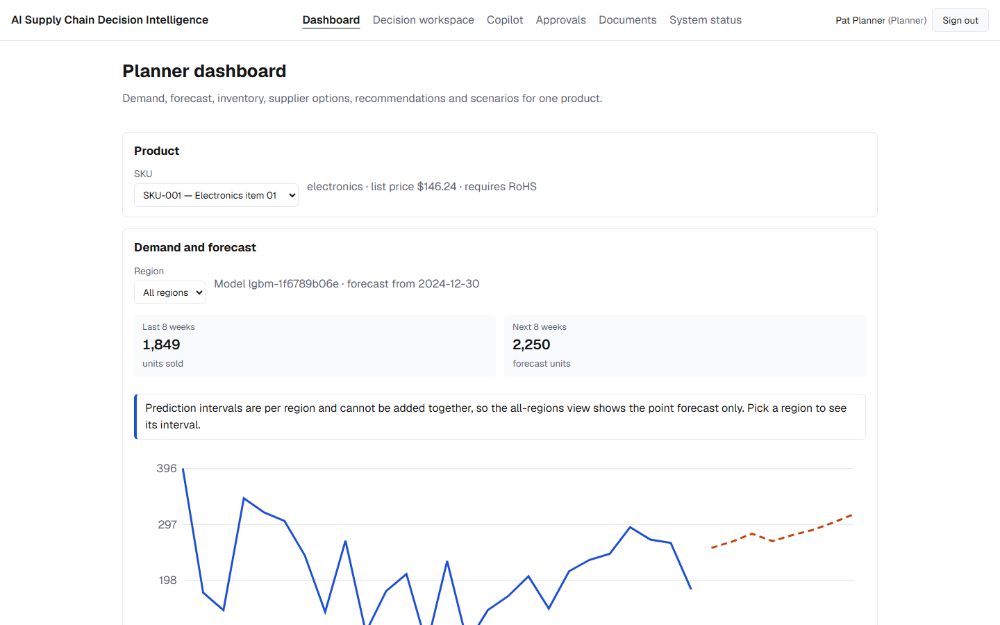
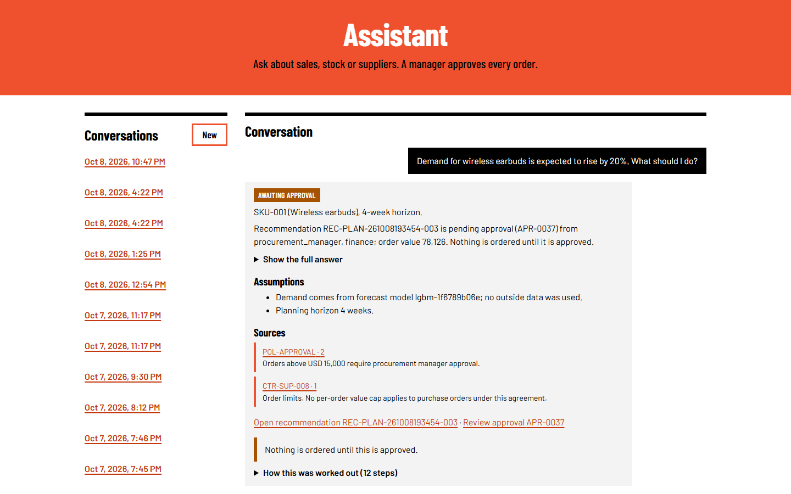
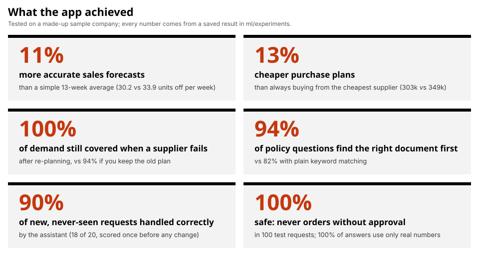
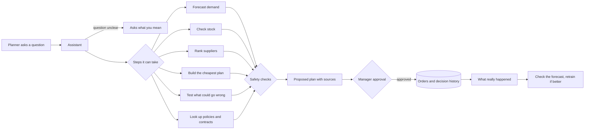

<div align="center">

# AI Supply Chain Planning & Optimization

**Forecast demand, pick suppliers and get the cheapest purchase plan. A person approves every order.**


[](LICENSE)



</div>

## Overview

Buying for a supply chain often means a pile of spreadsheets. Someone guesses next month's sales, compares supplier
prices, checks whether the warehouse has room, and then waits for a manager to sign off.

This project puts all of that in one app. You type a question, for example *"Demand for wireless earbuds is
expected to rise by 20%. What should I do?"* The app predicts sales, compares suppliers and builds the cheapest
purchase plan that fits every limit. It shows where each number came from. Nothing is ordered until the right
managers approve it.

## Key Features

- **Demand forecasts:** Predict sales for each product and region, with a low-to-high range.
- **Supplier ranking:** Compare suppliers on price, delivery time and reliability.
- **Cheapest purchase plan:** Respect every limit, including minimum order sizes, supplier capacity, warehouse space
  and budget.
- **What-if tests:** See what happens if something goes wrong, such as a supplier that stops delivering.
- **Answers from company documents:** Ask about policies and contracts. Each answer names the document and its
  version, and people only see documents their role may read ([details](docs/knowledge-retrieval.md)).
- **An assistant that doesn't make things up:** It only uses numbers that came from real data, explains its
  choices, asks when your question is unclear, and shows every step it took ([details](docs/agent.md)).
- **Manager approval:** The company's approval rules decide who must sign off, for example a procurement manager
  for orders above $15,000. Nobody can approve their own request, and every decision is saved
  ([details](docs/security.md)).
- **Learning from real results:** The app compares past forecasts with real sales. A retrained model replaces the
  old one only if it is more accurate and a named person approves the switch
  ([details](docs/feedback-loop.md)).
- **Background jobs:** Long plans and what-if tests run in the background, and the workers can scale on
  Kubernetes.

<div align="center">



</div>

## Results

<div align="center">



</div>

Compared with the simple way many teams plan today:

- **Better forecasts:** Sales forecasts are 11% more accurate than a simple 13-week average. On real data from an
  online store, the gain is smaller: 2.1%.
- **Cheaper plans:** Plans cost 13% less than always buying from the cheapest supplier, and they stay within every
  limit. When the budget is cut by 15%, the plan still fits the budget, while the simple rule goes over it.
- **Ready for problems:** If a supplier stops delivering, a new plan still covers 100% of demand. Keeping the old
  plan covers only 94%.
- **Right answers from documents:** For questions about policies and contracts, the correct document comes up
  first 94% of the time. Every answer shows its source.
- **Understands new requests:** On 20 requests it had never seen (scored once, before any change), the assistant
  handled 90% correctly.
- **Safe:** Across 100 test requests, it never placed an order without approval and never used a number that
  didn't come from real data.
- **Fast:** Most pages load in 10–60 ms, and a full assistant answer takes under a second.

All results come from a made-up sample company. Every number is read from a saved result file in
`ml/experiments/`. What still doesn't work well is listed under [Limitations](#limitations), and the full tables
are in [`docs/benchmarks.md`](docs/benchmarks.md).

## How It Works



The app has three parts:

- **Website** (Next.js): the pages that planners and managers use.
- **Backend** (Java, Spring Boot): sign-in, permissions, approvals and background jobs.
- **Planning engine** (Python): forecasts, supplier ranking, purchase plans, what-if tests, document search and the
  assistant.

All data lives in PostgreSQL: products, orders, approvals, the job queue, the history of changes and the document
search index. The saved results behind every number in this README are files in `ml/experiments/`.

## Technology Stack

| Component | Technology | Purpose |
|---|---|---|
| Website | Next.js 16, React 19, TypeScript | The pages planners and managers use |
| Backend | Java 21, Spring Boot 4, Flyway | Sign-in, permissions, approvals, background jobs |
| Planning engine | Python 3.12, FastAPI, LightGBM, SciPy (HiGHS solver) | Forecasts, purchase plans, what-if tests |
| Document search and assistant | fastembed, pgvector, BM25, optional Claude API | Find the right document and write answers |
| Database | PostgreSQL 16 with pgvector | Store all data |
| Data | A generated sample company, the Online Retail II dataset | Train and test the forecasts |
| Deployment | Docker Compose, Kubernetes (kind), Terraform for AWS | Run on one machine, a local cluster or the cloud |
| Monitoring | Micrometer, Prometheus | Health and speed numbers |
| Testing and CI | pytest, JUnit, Testcontainers, Vitest, Playwright, GitHub Actions, Trivy, Ruff, mypy | Tests, code checks and security scans |

## Getting Started

You need [Docker](https://www.docker.com/products/docker-desktop/), bash (Git Bash on Windows) and
[uv](https://docs.astral.sh/uv/). You don't need an API key or a cloud account.

**1. Get the code:**

```bash
git clone https://github.com/khoahonguyen0210/AI_Supply_Chain.git
cd AI_Supply_Chain
```

**2. Start everything.** The first run builds the images, so it takes a few minutes.

```bash
bash scripts/stack.sh up
```

When it finishes, it prints the address and a password. The password is also saved in `.env` as
`SCM_DEMO_PASSWORD`.

**3. Open http://localhost:3000.** Click **Create an account** to make your own. It can build plans and use the
assistant. Or sign in with one of the four demo accounts. They all use the password from step 2.

| User id | What they can do |
|---|---|
| `planner` | Ask the assistant, build plans, run what-if tests |
| `manager` | Approve orders (procurement manager) |
| `finance` | Approve large orders |
| `admin` | Everything, plus the Monitoring page |

**4. Try the main flow:**

1. Sign in as `planner`, open **Assistant** and ask: *Demand for wireless earbuds is expected to rise by 20%. What should I do?*
2. Sign out, sign in as `manager`, open **Approvals** and approve the new request.
3. Do the same as `finance`. The order is placed only after both approvals.

You can also run the same story as a script: `uv run python -m scm_ml.demo --password <password>`. A recorded run
is in [`docs/demo.md`](docs/demo.md).

**5. Stop it** with `bash scripts/stack.sh down`. Your data stays. Use `bash scripts/stack.sh reset` to delete the
data too.

| Service | Address |
|---|---|
| Website | http://localhost:3000 |
| Backend API | http://localhost:8080 |
| Metrics | http://localhost:8081/actuator/prometheus |

To run on a local Kubernetes cluster instead, use `bash scripts/kind.sh up` ([`docs/kubernetes.md`](docs/kubernetes.md)).

## Local Development

You need Java 21, Node.js 24 and uv.

```bash
uv sync --frozen                                         # Python environment
uv run python -m scm_ml.synthetic --out data/synthetic --seed 42   # generate the sample company
uv run python -m scm_ml.forecast --source synthetic      # train the forecast model
uv run python -m scm_ml.service                          # planning engine on port 8001

cd backend && ./mvnw spring-boot:run                     # backend on port 8080 (needs PostgreSQL)
cd frontend && npm ci && npm run dev                     # website on port 3000
```

The backend needs `SCM_JWT_SECRET`. The backend and the planning engine also share `SCM_ML_INTERNAL_TOKEN`. See
[Configuration](#configuration).

On Windows, an `&` in the folder path breaks `npm run` and the Maven wrapper in bash. Run frontend tools as
`node node_modules/<package>/...` and Maven as `.\mvnw.cmd` in PowerShell.

## Testing

```bash
bash scripts/check.sh                 # Python tests, code style and type checks
cd backend && ./mvnw verify           # Java tests (uses a real PostgreSQL in Docker)
cd frontend && npm run lint && npm run typecheck && npm test
bash scripts/e2e.sh                   # the whole flow through the real API
bash scripts/ai-regression.sh         # checks that the assistant and document search didn't get worse
bash scripts/stack.sh smoke           # quick check of the running app, including the demo
```

There are over 600 tests: 402 in Python, 136 in Java and 85 for the website, plus end-to-end and smoke tests. The
CI pipeline on GitHub runs all of them, builds the Docker images and scans them for known security problems
([`docs/ci.md`](docs/ci.md)).

## Re-running the Benchmarks

```bash
bash scripts/benchmark.sh            # redo every result, then docs/benchmarks.md (about 6 minutes)
bash scripts/benchmark.sh --real     # also use the real store data (downloads it once)
bash scripts/benchmark.sh --report   # only rebuild docs/benchmarks.md from the saved files
uv run python -m scm_ml.benchmark.figure                                          # the results chart
uv run python -m scm_ml.benchmark.latency --password <password>                   # speed, needs the app running
uv run python -m scm_ml.benchmark.scaling --replicas 1 2 4 --jobs 48 --repeats 3  # workers, needs kind
```

A re-run from a fresh copy of the repository reproduced every saved result. Only the timings differed
([`docs/definition-of-done.md`](docs/definition-of-done.md)).

## API

| Method | Endpoint | What it does |
|---|---|---|
| POST | `/api/auth/login` | Sign in and get a token |
| POST | `/api/auth/register` | Create a planner account and sign in |
| POST | `/api/agent/tasks` | Ask the assistant |
| POST | `/api/forecasts` | Forecast demand, with a low-to-high range |
| POST | `/api/suppliers/search` | List suppliers that can deliver, best first |
| POST | `/api/jobs` | Build a plan or run a what-if test in the background |
| POST | `/api/scenarios/{id}/runs` | Test a plan against a problem |
| POST | `/api/documents/ask` | Ask about policies and contracts |
| GET | `/api/approvals/{id}` | See an approval request and its decisions |
| POST | `/api/approvals/{id}/decision` | Approve or reject |
| POST | `/api/outcomes/demand` | Record real sales (also deliveries and stock) |
| GET | `/api/outcomes/evaluation` | Compare a decision with what really happened |
| GET | `/api/ops/summary` | System health (admin only) |

The full list is in [`docs/backend-api.md`](docs/backend-api.md).

## Configuration

The first time you run `scripts/stack.sh up`, it creates a `.env` file with random passwords. This file is never
committed. Every other setting has a default in `.env.example` and `application.yml`.

| Variable | What it is |
|---|---|
| `SCM_JWT_SECRET` | The key that signs sign-in tokens (at least 32 characters, no default) |
| `SCM_ML_INTERNAL_TOKEN` | A shared password between the backend and the planning engine |
| `SCM_DEMO_PASSWORD` | The password of the four demo accounts |
| `SCM_SECURITY_ALLOWSIGNUP` | Set to `false` to turn off "Create an account" (default `true`) |
| `POSTGRES_HOST`, `POSTGRES_DB`, `POSTGRES_USER`, `POSTGRES_PASSWORD` | Database connection |
| `SCM_ML_PLANNER` | `rule` (default, works offline) or `claude` |
| `ANTHROPIC_API_KEY` | Only needed when `SCM_ML_PLANNER=claude` |
| `SCM_JOBS_WORKER_ENABLED` | Whether this backend also runs background jobs |
| `SCM_VERSION` | The Docker image tag (default `local`) |

## Repository Layout

```text
backend/          Java backend: sign-in, permissions, approvals, jobs, database changes
frontend/         The website
ml/src/scm_ml/    Planning engine, evaluations, benchmarks, demo
ml/experiments/   Saved results (the source of every number in this README)
src/scm_common/   Data definitions shared by the Python code
infrastructure/   Dockerfiles, Kubernetes files, Terraform
scripts/          Scripts to start, stop, test and benchmark
docs/             Design notes, results, demo
```

## Deployment

`compose.yaml` runs everything on one machine. `infrastructure/kubernetes` runs it on a local Kubernetes cluster,
where you can add more background workers. `infrastructure/terraform` describes how it would run on AWS: containers
behind a load balancer, a managed PostgreSQL database, file storage, secrets and alarms. The Terraform files pass
all checks but have never been deployed to a real AWS account. [`docs/cloud.md`](docs/cloud.md) lists the local
version of each AWS piece.

## Security

- **Sign-in:** You sign in with a password and get a token that lasts 8 hours by default. Passwords must be 12 to 72
  characters and are stored scrambled (hashed), never as plain text.
- **Roles:** Anyone can create an account, but a new account can only plan. An admin gives out the approval roles.
  Every request checks your role: planner, procurement manager, finance or admin.
- **Abuse limits:** The app limits how often someone can try to sign in or send requests.
- **History of changes:** Every change and every refused request is written to a log that nobody can edit.
- **Internal access:** The planning engine only accepts requests from the backend.
- **Web and cloud:** The website sends strict security headers. The AWS setup refuses to deploy without HTTPS unless
  you allow plain HTTP on purpose.
- **Local use:** The ports are only open on your own computer, and the demo accounts are for local use only.

More in [`docs/security.md`](docs/security.md).

## Limitations

- **The company is made up.** Real data is only used to test the forecast, and the "what really happened" data in
  the learning loop is simulated.
- **The assistant can still be confused.** The built-in assistant mixes keyword rules with matching by meaning.
  On sets of new requests it scored between 50% and 90% (90% on the newest set of 20), so unusual wording can
  still trip it up. A Claude-based version exists, but its results are NOT YET measured because no API key was used.
- **Small gain on real data.** The forecast is only 2.1% better than a simple 13-week average.
- **The forecast range is a bit too wide.** On the sample company, real sales fall inside it 88% of the time instead
  of 80%. A model retrained on new data was slightly worse, so it was not used.
- **Plans treat 4 weeks as one block.** They can miss timing problems inside those weeks. On paper a plan covers
  90.8% of each week's demand, but in the simulation it covered 80.3%.
- **One planning engine only.** It keeps the assistant's state in a single SQLite file, so it runs as one copy.
  Only the background workers can scale.
- **Not deployed.** The Terraform files have never been used on a real AWS account.

## What's Next

The whole flow works today, from question to approved order. The next steps come from the limitations above:

- [ ] Measure the Claude-based assistant and compare it with the built-in one.
- [ ] Plan week by week instead of in one 4-week block.
- [ ] Share the assistant's state so the planning engine can run as several copies.
- [ ] Test the forecast on more real datasets.
- [ ] Deploy to a real AWS account and run the end-to-end test there.

## Glossary

| Term | Meaning |
|---|---|
| Low-to-high range | The band where real sales should land 80% of the time |
| Units off per week | The forecast error: how far the forecast was from real sales, on average |
| Plan builder | The part that finds the cheapest plan that meets every limit |
| What-if test | Running a plan again with a problem added, such as a late or missing supplier |
| Safety buffer | Extra stock kept in case something goes wrong |

## Author

This is a personal project, built from start to finish by one person. Issues and suggestions are welcome.

| Name | Role | GitHub |
|---|---|---|
| Khoa Ho Nguyen | Author and maintainer | [@khoahonguyen0210](https://github.com/khoahonguyen0210) |

## License

MIT. See [`LICENSE`](LICENSE).
