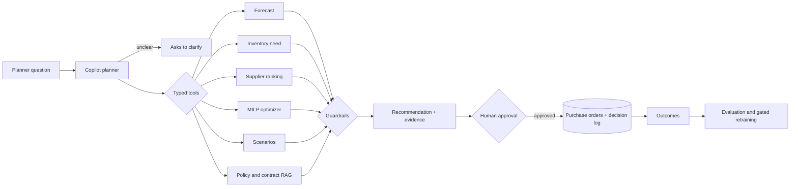

<div align="center">

# AI Supply Chain Decision Intelligence Platform

**Ask a vague planning question. Get a costed, constraint-checked purchase plan, the evidence behind every number, and nothing ordered until the right people approve it.**


[](LICENSE)


</div>

```text
"I'm worried we will run short on something next month. What should I do?"
"Demand for SKU-001 is expected to rise by 20%. What should I do?"
```

## Results

<div align="center">


</div>

Planning results are for a synthetic company (seed 42, planning date 2024-12-30); the forecast is also tested on real retail data. Every number comes from a saved artifact in `ml/experiments/`, and the full tables are generated into [`docs/benchmarks.md`](docs/benchmarks.md).

| Measure | Reference | This platform |
|---|---|---|
| Demand forecast, synthetic (test MAE, 200 series) | 33.914, best of four baselines | **30.158** with LightGBM, 11.1% lower |
| Demand forecast, real retail data (test MAE) | 58.156 | **56.936**, 2.1% lower |
| Procurement cost, 40 SKUs x 3 warehouses | 348,675 cheapest supplier, 357,384 weighted ranking | **302,532** with the MILP, 13.2% and 15.3% lower, 0 constraint violations |
| Procurement under a 15% tighter budget | both heuristics overspend | **within budget** (253,585 of 253,586) at fill rate 1.000 |
| Supplier outage | holding the plan: fill rate 0.941, cost 412,045 | **re-optimizing:** fill rate 1.000, cost 306,750 |

| Other measures | Result |
|---|---|
| Policy and contract retrieval (56 questions, 69 documents) | hit@1 **0.941**, citation accuracy **1.000**, groundedness **1.000**, **0** restricted-document leaks |
| Copilot, 40 evaluation cases | action safety and permission compliance **1.000**; workflow success **1.000** on development cases but **0.222** on 9 hold-out cases |
| 80% forecast intervals | cover **0.876** on synthetic data (over-cover), **0.783** on real data |
| Retraining on newly captured weeks | candidate MAE **31.279** against **31.176**, so the gate kept the current model |
| Job throughput on kind | **32.0 / 79.1 / 99.6** optimization jobs per minute with 1 / 2 / 4 workers |
| API latency, p50 on Docker Compose | catalog reads **11-14 ms**, forecast **59 ms**, document question **100 ms**, full copilot task **981 ms** |

How each number was produced is in [`docs/forecasting.md`](docs/forecasting.md), [`docs/optimization.md`](docs/optimization.md), [`docs/scenarios.md`](docs/scenarios.md), [`docs/rag-evaluation.md`](docs/rag-evaluation.md), [`docs/agent-evaluation.md`](docs/agent-evaluation.md) and [`docs/kubernetes.md`](docs/kubernetes.md). Weak and negative findings are under [Limitations](#limitations).

## How it works



The Next.js frontend talks to a Spring Boot backend, which owns users, roles, approvals, the job queue and the audit log in PostgreSQL. The backend calls a Python planning engine (FastAPI) for forecasting, sourcing, optimization, scenarios, retrieval and the copilot, authenticated with a shared internal token.

## Explainable recommendations

<div align="center">


</div>

- **Every number comes from a tool.** The copilot calls typed tools (forecast, inventory need, supplier search, optimizer, scenarios, policy search) and a guardrail rejects any number in the answer that no tool returned.
- **Trade-offs are spelled out.** The answer says why the optimizer buys mostly from a lower-ranked supplier, what a 20% demand shock or a supplier outage would cost if the plan were held, and what re-optimizing saves.
- **Vague questions are not guessed at.** A question without a product gets a clarifying question back, not an invented plan.
- **Every trace is kept.** "How this was worked out" shows each tool call with its arguments and result.

Details are in [`docs/agent.md`](docs/agent.md).

## Approval before anything is ordered

A recommendation only becomes purchase orders after the roles named by the approval policy sign it off, for example a procurement manager and finance above an order value. The requester cannot approve their own request, the copilot cannot approve anything, every decision is an append-only record, and every request and refusal is in the audit log. Details are in [`docs/security.md`](docs/security.md).

## Evidence from policies and contracts

Policy and contract questions are answered from 69 versioned documents with hybrid retrieval (bge-small-en-v1.5 embeddings in pgvector plus BM25). Each answer cites document and version; expired or superseded clauses are flagged, missing evidence is refused, and passages a role may not see are never returned to it. On 56 labelled questions the answer cites the right source every time and leaks no restricted document. Details are in [`docs/knowledge-retrieval.md`](docs/knowledge-retrieval.md) and [`docs/rag-evaluation.md`](docs/rag-evaluation.md).

## Learning from outcomes

When a recommendation is approved, the forecast it relied on is snapshotted. Actual demand, supplier deliveries and inventory are recorded later through the API, and the backend scores the decision against them. A retraining command trains a candidate on the new weeks and compares it with the served model on weeks neither has seen; it can be promoted only if it beats the current model and its intervals stay calibrated, and only by a named approver.

```bash
uv run python -m scm_ml.feedback retrain
uv run python -m scm_ml.feedback promote --report <report.json> --approved-by <name>
```

On four simulated weeks the candidate scored MAE 31.279 against 31.176 for the served model, so the gate rejected it. Details are in [`docs/feedback-loop.md`](docs/feedback-loop.md).

## Tech stack

| Area | Tools |
|---|---|
| Languages | Java, Python, TypeScript, SQL, HCL (Terraform), CSS |
| Backend | Java 21, Spring Boot 4 (Web MVC, Security with JWT, JDBC, Validation, Actuator), Flyway, Maven |
| Frontend | Next.js 16, React 19, TypeScript, Vitest, Testing Library |
| ML and optimization | Python 3.12, LightGBM, NumPy, pandas, SciPy (HiGHS MILP), FastAPI, Pydantic |
| LLM and retrieval | fastembed (bge-small-en-v1.5), pgvector, BM25; Claude API optional behind an offline rule planner |
| Data | PostgreSQL 16 + pgvector, synthetic company generator, Online Retail II |
| Infra | Docker Compose, Kubernetes (kind), Terraform, AWS (ECS Fargate, RDS, S3, EFS, ECR) |
| Observability | Micrometer, Prometheus endpoint, AI telemetry, audit log |
| CI and quality | GitHub Actions, Trivy, pip-audit, npm audit, Ruff, mypy, pytest, JUnit, Testcontainers, actionlint, tflint |

## Quick start

You need Docker with Compose v2, bash (Git Bash on Windows) and [uv](https://docs.astral.sh/uv/). No API key or cloud account is needed: the copilot runs on an offline planner by default.

```bash
bash scripts/stack.sh up      # builds the images, generates .env secrets, migrates and seeds the database
```

It prints the URL and the demo password. Sign in as `planner`, `manager`, `finance` or `admin`, or run the scripted demo, one decision in eleven steps from a vague question to an evaluated outcome:

```bash
uv run python -m scm_ml.demo --password <demo password>
```

| Service | URL |
|---|---|
| Frontend | http://localhost:3000 |
| Backend API | http://localhost:8080 |
| Metrics (Prometheus) | http://localhost:8081/actuator/prometheus |

Stop with `bash scripts/stack.sh down`, or `reset` to delete the data too. A recorded demo run is in [`docs/demo.md`](docs/demo.md). On Kubernetes: `bash scripts/kind.sh up` ([`docs/kubernetes.md`](docs/kubernetes.md)).

## Local development

This needs JDK 21, Node.js 24 and uv. The engine serves a model trained from the synthetic company:

```bash
uv sync --frozen
uv run python -m scm_ml.synthetic --out data/synthetic --seed 42
uv run python -m scm_ml.forecast --source synthetic       # deterministic
uv run python -m scm_ml.service                           # engine on :8001

cd backend && ./mvnw spring-boot:run                      # API on :8080, needs PostgreSQL
cd frontend && npm ci && npm run dev                      # UI on :3000
```

The backend needs `SCM_JWT_SECRET`, and backend and engine share `SCM_ML_INTERNAL_TOKEN` (see [Configuration](#configuration)). On Windows, an `&` in the checkout path breaks npm's `.cmd` shims and the Maven wrapper from bash: run the frontend tools as `node node_modules/<package>/...` and Maven as `.\mvnw.cmd` in PowerShell.

## Testing

```bash
bash scripts/check.sh                 # Python: pytest, ruff, ruff format, mypy --strict
cd backend && ./mvnw verify           # Java, against real PostgreSQL through Testcontainers
cd frontend && npm run lint && npm run typecheck && npm test
bash scripts/e2e.sh                   # PostgreSQL + backend jar + engine, through the public API
bash scripts/ai-regression.sh         # fixed RAG and copilot cases against a baseline
bash scripts/stack.sh smoke           # the running stack, including the demo
```

There are over 600 tests: 398 in Python, 130 in Java and 80 in the frontend, plus end-to-end and smoke tests. CI runs lint, type checks and tests for all three code bases, the end-to-end test, the container stack with a smoke test, a Trivy image scan, dependency audits and Terraform checks ([`docs/ci.md`](docs/ci.md)).

## Benchmarks

```bash
bash scripts/benchmark.sh            # regenerate every offline artifact, then docs/benchmarks.md
bash scripts/benchmark.sh --real     # also the real-data forecast (downloads the dataset once)
bash scripts/benchmark.sh --report   # only rebuild the report from the saved artifacts
uv run python -m scm_ml.benchmark.figure                                          # docs/images/results.svg
uv run python -m scm_ml.benchmark.latency --password <demo password>              # needs the stack
uv run python -m scm_ml.benchmark.scaling --replicas 1 2 4 --jobs 48 --repeats 3  # needs kind
```

The offline suite takes about 6 minutes. Rerun from a clean clone, it reproduced every committed metric; only run times differ ([`docs/definition-of-done.md`](docs/definition-of-done.md)).

## API

| Method | Endpoint | Purpose |
|---|---|---|
| POST | `/api/auth/login` | Sign in, returns a JWT |
| POST | `/api/agent/tasks` | Ask the copilot |
| POST | `/api/forecasts` | Demand forecast with intervals |
| POST | `/api/suppliers/search` | Eligible suppliers, ranked with reasons |
| POST | `/api/jobs` | Optimization or scenario run as an async job |
| POST | `/api/scenarios/{id}/runs` | Run a what-if scenario against a plan |
| POST | `/api/documents/ask` | Cited answer from policies and contracts |
| GET | `/api/approvals/{id}` | Approval, recommendation and decisions |
| POST | `/api/approvals/{id}/decision` | Approve or reject |
| POST | `/api/outcomes/demand` | Record actual demand (also deliveries, inventory) |
| GET | `/api/outcomes/evaluation` | Score a decision against its outcomes |
| GET | `/api/ops/summary` | Operations summary (admin) |

Full list and rules: [`docs/backend-api.md`](docs/backend-api.md). Engine contracts: [`docs/contracts/engine-api.md`](docs/contracts/engine-api.md).

## Configuration

`scripts/stack.sh up` writes `.env` (git-ignored) with random local secrets on first run. Defaults for the rest are in `.env.example` and `application.yml`, and environment variables override them.

| Variable | Purpose |
|---|---|
| `SCM_JWT_SECRET` | JWT signing key, 32 bytes or more, no default |
| `SCM_ML_INTERNAL_TOKEN` | Shared token between backend and engine |
| `SCM_DEMO_PASSWORD` | Password of the four demo users |
| `POSTGRES_HOST`, `POSTGRES_DB`, `POSTGRES_USER`, `POSTGRES_PASSWORD` | Database |
| `SCM_ML_PLANNER` | `rule` (default, offline) or `claude` |
| `ANTHROPIC_API_KEY` | Only for `SCM_ML_PLANNER=claude` |
| `SCM_JOBS_WORKER_ENABLED` | Whether this backend instance runs queued jobs |
| `SCM_VERSION` | Image tag used by Compose, default `local` |

## Repository layout

```text
backend/          Spring Boot API, security, jobs, approvals, outcomes, Flyway migrations V1-V7
frontend/         Next.js app
ml/src/scm_ml/    Planning engine, evaluations, feedback loop, benchmarks, demo
ml/experiments/   Saved benchmark artifacts, the source of every reported number
src/scm_common/   Shared domain schema
infrastructure/   Dockerfiles, Kubernetes manifests, Terraform
scripts/          Stack, kind, end-to-end, checks, benchmarks, screenshots
.github/          CI workflows
docs/             Design notes, contracts, results, demo, resume evidence
```

## Deployment

`compose.yaml` runs the full stack locally, and `infrastructure/kubernetes` runs it on kind with scalable job workers. `infrastructure/terraform` maps it to AWS: VPC, ECS Fargate services behind an ALB, RDS PostgreSQL with pgvector, EFS for engine state, S3, ECR, Secrets Manager, IAM roles per service, CloudWatch alarms, and a GitHub OIDC role for pushing images. It passes `fmt`, `validate` and `tflint`, but has never been applied to a live AWS account. Every cloud piece and its local equivalent are listed in [`docs/cloud.md`](docs/cloud.md).

## Security

Users sign in with a password and get a signed JWT (8 hours by default); every API call checks the role (planner, procurement manager, finance, admin). Requests are rate-limited per user, every request and refusal goes to an append-only audit log, and the engine only accepts calls carrying the backend's internal token. Published ports bind to 127.0.0.1 only. The demo users and generated passwords are for local use. Details are in [`docs/security.md`](docs/security.md).

## Limitations

- The company is synthetic. Real data is used only for the forecast benchmark, and outcomes in the feedback loop are simulated.
- The offline rule planner generalises poorly: 2 of 9 hold-out tasks succeed. The Claude planner and LLM-written RAG answers exist behind the same interfaces but are NOT YET MEASURED.
- Forecast intervals over-cover on synthetic data, and the real-data gain over a 13-week average is small (2.1%).
- The optimizer plans a single 4-week period and ignores timing inside it: replayed week by week, the plan's fill rate is 0.908, and 0.803 against simulated actuals.
- The engine keeps copilot state in SQLite and runs as one instance; only job workers scale.
- The GitHub Actions workflows have not run on GitHub yet, and the Terraform has not been applied.

## Author

This is a personal project, built end to end by one person. Issues and suggestions are welcome.

| Name | Role | Github |
|---|---|---|
| Khoa Ho Nguyen | Author and maintainer | [@khoahonguyen0210](https://github.com/khoahonguyen0210) |

## License

MIT. See [`LICENSE`](LICENSE).
